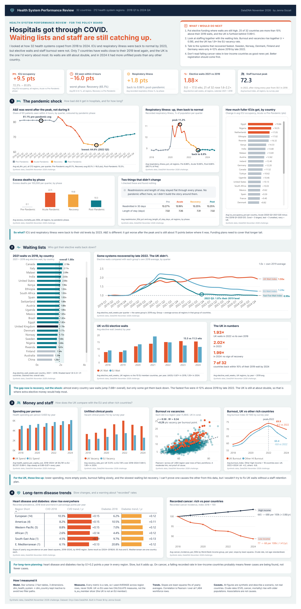

# Health System Performance Review, 2018–2024

My entry for the Onyx Data **DataDNA November 2026** challenge, built in Power BI.



📄 [Full report (PDF)](Health_System_Dashboard.pdf) · 📊 [Power BI file (.pbix)](Health_System_DataDNA_Nov2026.pbix)

> **Synthetic data.** The dataset was simulated for the DataDNA challenge. Country names and reference attributes are real, but every performance, workforce and spending figure is made up. The findings below describe the challenge scenario, not real countries.

## The question

How did health systems in 32 countries absorb the pandemic shock, and who recovered?

For this challenge I took the role of a health system performance analyst reporting to the board of an international policy unit. The board makes funding and workforce decisions, so I tried to give every finding a clear number and say how I measured it.

## What I found

**1. Acute care recovered, A&E didn't.**
ICU occupancy rose 9.5 points in the Acute Pandemic phase (72.3% → 81.8%), and recorded respiratory illness rose 1.8 points before returning to its earlier level by 2023. Emergency department 4-hour performance was different: it hit its lowest point in the Recovery phase, not during the peak, at 16 points below its pre-pandemic level (81.1% → 65.1%). It's still about 11 points below.

**2. Waiting lists doubled, and most haven't come back down.**
Average elective waits rose 1.88× from 2019 to 2021, and 21 of 32 countries saw a rise between 1.6× and 2.2×. Only 7 countries are back within 10% of their 2019 wait. Sweden, Norway, Denmark, Finland and Germany recovered fastest (4–12% above 2019 by the second half of 2022). In this scenario the UK is furthest behind: its waits were 1.93× its 2019 level in 2022, 2.02× in 2023 and 1.99× in 2024, and 1.35× the EU average in 2024.

**3. Spending and staffing point the same way for the UK.**
In this scenario the UK spends 14% less per person than the EU members ($4,781 vs $5,537, 2018–2024). Its vacancy rate is 1.66× the EU's over the period (1.90× in 2024, the highest of all 32 countries).

**4. Burnout peaked in 2022 and moves with vacancies.**
The burnout index rose every year from 58.1 in 2018 to a peak of 72.3 in 2022. Across all 1,484 region-years, burnout and vacancy rates have a moderate positive link (r = 0.58). From 2022 to 2024, UK burnout fell 4.2 points against 8.8 for the other high-income countries.

**5. Chronic disease rises slowly everywhere.**
Recorded heart disease and diabetes rise by about 0.1–0.2 percentage points a year in every WHO region. Recorded cancer rises in high-income countries (+3.88 per 100k a year) and falls in low-income ones (−1.41). I read the fall as a likely sign of weaker detection and registration, not less cancer.

**What I tested and didn't find:** 30-day readmissions (13.2–13.3%) and average length of stay (about 7.3 days) didn't change in any pandemic phase.

## What I'd recommend

1. Put elective funding where waits are still high. The UK is furthest behind.
2. Plan staffing together with the waiting lists. Burnout and vacancies rise together, though this data can't prove one causes the other.
3. Talk to the systems that recovered fastest: Sweden, Norway, Denmark, Finland and Germany.
4. Don't read falling cancer rates in low-income countries as good news before registration improves.

## How I built it

**Data model.** A star schema with two fact tables (`fact_health_performance`, quarterly; `fact_workforce`, annual survey) and three dimensions (`dim_country`, `dim_date`, `dim_health_system`). I kept the `dim_health_system → dim_country` relationship inactive so each fact table has only one filter path to country.

**Measures.**
- Every metric is a rate, share or index, so every base measure uses `AVERAGE`, never `SUM`.
- Phase comparisons use `CALCULATE` with `REMOVEFILTERS(dim_date)` and a filter on `pandemic_phase`.
- UK vs EU and UK vs other high-income countries use separate `CALCULATE` measures, not the `is_eu_member` slicer, because the UK isn't an EU member and "not EU" would mix it with 21 other countries.
- "Similar rise" means a 2021 ÷ 2019 ratio between 1.6× and 2.2×.

**Trends.** Slopes are least-squares fits of yearly averages (2018–2024), written in DAX with `SUMX`. The burnout–vacancy link is Pearson r over all 1,484 workforce rows.

Example measure:

```dax
CVD Slope per Year =
VAR Yearly =
    ADDCOLUMNS ( VALUES ( dim_date[year] ), "@Avg", CALCULATE ( [Avg CVD] ) )
VAR xbar = AVERAGEX ( Yearly, dim_date[year] )
VAR ybar = AVERAGEX ( Yearly, [@Avg] )
RETURN
    DIVIDE (
        SUMX ( Yearly, ( dim_date[year] - xbar ) * ( [@Avg] - ybar ) ),
        SUMX ( Yearly, ( dim_date[year] - xbar ) ^ 2 )
    )
```

**Caveats.** All figures are synthetic. Heart disease, cancer and mortality are crude rates, so countries with older populations show higher values. Associations aren't causes.

## Files in this repository

| File | What it is |
|---|---|
| `Health_System_DataDNA_Nov2026.pbix` | The Power BI report (open in Power BI Desktop) |
| `Health_System_Dashboard.pdf` | The full report as a PDF |
| `Health_System_Dashboard.png` | The report as an image |
| `data/` | The five CSV files and the dataset README |
| `docs/CHALLENGE_BRIEF.md` | The challenge brief |
| `docs/DATA_DICTIONARY.md` | Column-level documentation for every table |

## Credits

Dataset: DataDNA November 2026 challenge (synthetic data), by [Onyx Data](https://datadna.onyxdata.co.uk), released under CC BY 4.0. Reference attributes come from public sources listed in `data/README.md`.

Built by **Jenna Gozali** · [LinkedIn](https://www.linkedin.com/in/jennagozali)
